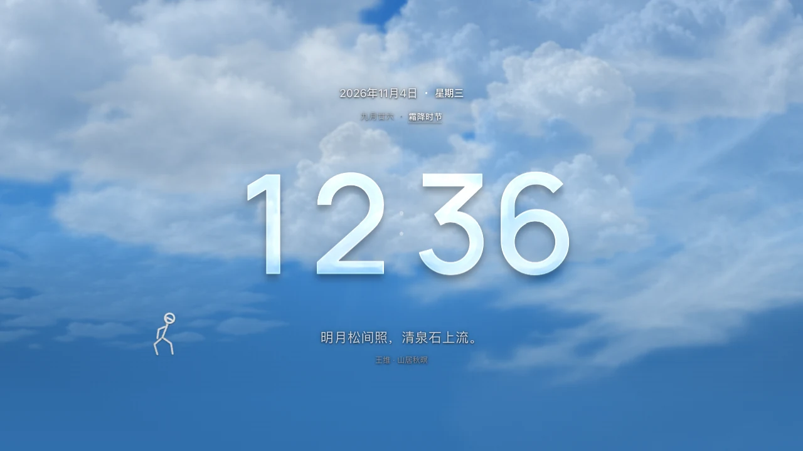
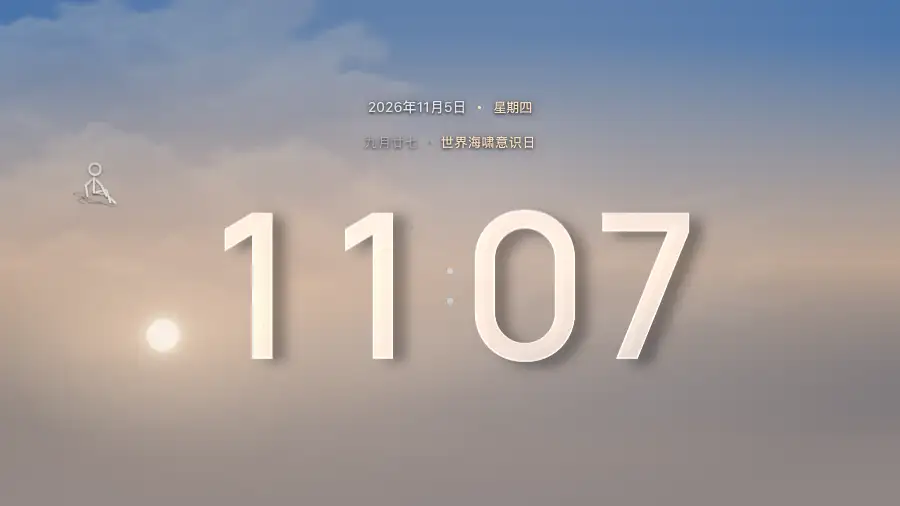

# 浮光时钟 · Flowlight

浮光是一款可以离线使用的全屏天气时钟。清晨，第一束暖光落在玻璃数字上。到了正午，云影从钟面掠过。入夜后，抬眼看时间，背后是一片缓缓移动的星空。英文名 **Flowlight** 取意「流动的光」。

**下载**　[Windows / Mac 通用版][desktop]　·　[安卓手机 / 平板版][phone]　·　[安卓电视轻量版][tv]

## 选一个版本，打开就能用

| 你的设备 | 下载 | 第一次打开 |
| --- | --- | --- |
| Windows 或 Mac 电脑 | [通用 ZIP · 1.4.0][desktop] | 解压，双击文件夹里的 **浮光时钟.html**，用浏览器打开。也可以把 ZIP 转发给朋友。 |
| 安卓手机或平板 | [手机 APK · 1.4.0][phone] | 在设备的「文件」中点开 APK 安装，再打开「浮光时钟」。适用于 Android 8.0 及以上，系统 WebView 建议使用 Chromium 90 或更新版本。 |
| 可以安装 APK 的安卓电视 | [电视 APK · 1.0.4][tv] | 用 U 盘或电视的文件传输功能复制 APK，在电视上安装「浮光·TV」。需要 Android 6.0 及以上、Chromium 66 或更新的系统 WebView。 |

手机和电脑都有玻璃翻页、沉浸天空和节气日历。**浮光·TV** 为低内存横屏电视设计，使用大号数字、持续飘动的云和轻量雨雪动画。左侧用遥控器选设置，右侧就能看到效果。按一次确认键即可全屏，也可以等待 15 秒自动进入。

## 用一分钟看完一天

在手机或电脑上，打开 **显示 → 天气与昼夜动效 → 昼夜快放**。天空会在 60 秒内走过清晨、正午、黄昏和深夜，钟面始终显示现在的时间。试着在同一处选一次晴天，再选一次大雨，看看云层怎样遮住太阳，玻璃数字的亮边又怎样暗下来。

*上图取自正式版的一次全屏快放，压缩为约 6 秒的循环动图。*

看完预览，点 **回到实时天气**。在 **显示 → 实时天气与位置** 选择自己的城市，或点 **使用当前位置**。默认城市是杭州西湖区。应用在前台约每 10 分钟尝试更新一次天气，雨停、云散和日落会叠加在同一条时间线上。

## 让钟面适合你

- **想从远处看清时间**，在 **显示 → 时钟与液态玻璃** 里调大数字、加粗字体、隐藏秒数。关掉液态玻璃就能用普通数字看时间，也可以单独调整日期和星期的大小。
- **想让房间暗一点**，关掉 **天气铺满屏幕**，四周会渐变为纯黑。打开后，云层和天空会延伸到屏幕边缘。
- **想看今天是什么日子**，在 **显示 → 钟面内容** 里选 **节日日历** 或 **节日＋金句**。点钟面上的节气名称，可以播放对应的天气彩蛋。在 **每日金句** 里也能换成自己写的一句话。1.4.0 收录了 2026 年全部 24 个节气和 29 个精选节日、纪念日。其他年份仍可查看公历和农历。
- **想让桌面有个伴**，轻点火柴人和它打招呼，或把它拖到屏幕另一边。进入全屏后也能互动。

## 使用中遇到问题

**断网还能用吗？** 可以。时间、字体、云层、星空和诗句都保存在本地。天气服务暂时连不上时，应用会沿用最近有效的天气记录。没有可用记录时，用晴天继续呈现当地昼夜。

**一定要开定位吗？** 可以手动选城市。只有选择定位并授权后，应用才会取当前位置查询天气。国内优先使用中国气象局的数据，查询失败时尝试 Open-Meteo。字体、城市和显示偏好会保存在当前设备。

**全屏怎么退出？** 电脑按 Esc 或双击空白处。安卓手机也可以按系统返回键。电视按确认键打开设置，在纯时钟画面按返回键可退出应用。

**安卓提示无法安装，或装好后打不开？** 如果提示缺少安装权限，按系统提示允许当前文件管理器安装 APK。如果装好后出现网页组件提示，先确认下载的是对应设备的版本，再检查系统 WebView 是否启用、版本是否满足上表要求。[手机安装说明](outputs/安卓安装说明.txt) · [电视安装说明](outputs/电视版安装说明.txt)

**想反馈问题或提建议？** 请写下设备型号、系统版本、使用的是哪个版本，以及当时点了什么。画面问题可以附一张截图。[提交反馈](https://github.com/JahanHe/Flowlight/issues/new)

## 版本、源码与素材

[下载与更新记录](https://github.com/JahanHe/Flowlight/releases) · [按功能查找源码](docs/PROJECT-MAP.md) · [从源码构建](docs/BUILD.md) · [测试说明](docs/TESTING.md)

银河影像来自 ESO/S. Brunier，行星和星系影像的逐图署名、云图来源与加工说明收录在[素材说明](docs/PROJECT-MAP.md#素材与署名)。数字使用[内嵌字体](work/font-licenses.txt)，日月位置计算使用 [SunCalc](work/references/suncalc-LICENSE)。

[desktop]: https://github.com/JahanHe/Flowlight/releases/download/v1.4.0/Fuguang-Clock-1.4.0-Desktop.zip
[phone]: https://github.com/JahanHe/Flowlight/releases/download/v1.4.0/Fuguang-Clock-1.4.0-Android.apk
[tv]: https://github.com/JahanHe/Flowlight/releases/download/tv-v1.0.4/Fuguang-TV-1.0.4.apk
