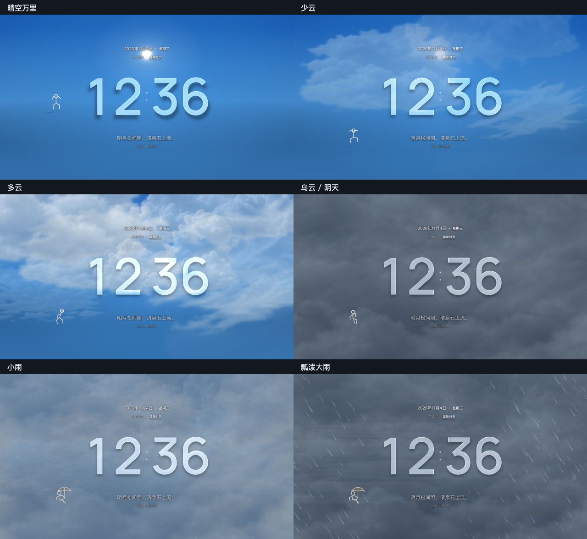

# 浮光时钟

一个可以离线打开的液态玻璃翻页时钟。太阳、月亮、云层和雨势会改变数字上的光色。可以让时钟按真实时间运行，也可以在一分钟内看完全天光影。

## 下载与使用

| 设备 | 当前版本 | 怎么用 |
| --- | --- | --- |
| Windows 或 Mac | [通用版 1.4.0](https://github.com/JahanHe/fuguang-clock/releases/download/v1.4.0/Fuguang-Clock-1.4.0-Desktop.zip) | 解压到任意文件夹，双击里面的「浮光时钟.html」。 |
| 安卓手机 | [手机版 APK 1.4.0](https://github.com/JahanHe/fuguang-clock/releases/download/v1.4.0/Fuguang-Clock-1.4.0-Android.apk) | 下载安装到手机后打开。[安装说明](outputs/安卓安装说明.txt) |
| 安卓电视 | [浮光·TV 1.0.4](https://github.com/JahanHe/fuguang-clock/releases/download/tv-v1.0.4/Fuguang-TV-1.0.4.apk) | 将 APK 传到电视安装，用方向键和确认键操作。[电视安装说明](outputs/电视版安装说明.txt) |

下载 ZIP 或克隆本仓库后，打开 `outputs/glass-clock.html` 即可使用正式网页。日历与节气的离线演示在 `outputs/浮光-日历金句-本地演示.html`。网页、字体和图像都在本地；实时天气使用网络，默认城市是杭州西湖区。

## 项目怎么维护

- [项目地图](docs/PROJECT-MAP.md)按屏幕功能定位到源码，也列出了云图、天文影像、字体和第三方许可。
- [构建说明](docs/BUILD.md)覆盖共享网页、手机 APK、通用 ZIP 和电视冻结版本。[测试说明](docs/TESTING.md)列出运行验收的方法。
- [版本记录](CONTEXT.md)记录产品取舍和每次验收的范围。手机版与通用版同步发布，电视轻量版单独维护。
- [历史安装包](outputs/)按版本保留。[设计与验收档案](https://github.com/JahanHe/fuguang-clock/releases/tag/project-archive-2026-11)保存历次动画、截图和测试结果，[文件索引](docs/archive-index.tsv)可按文件名查找对应压缩包。
